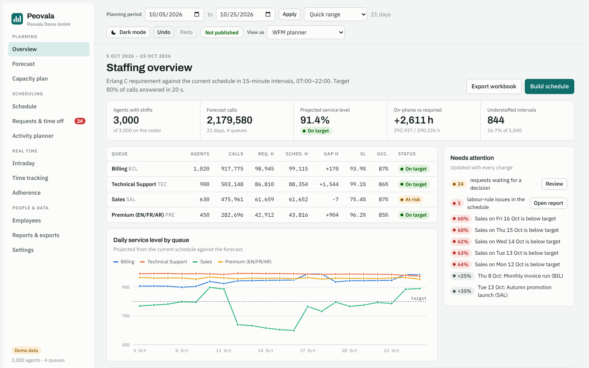
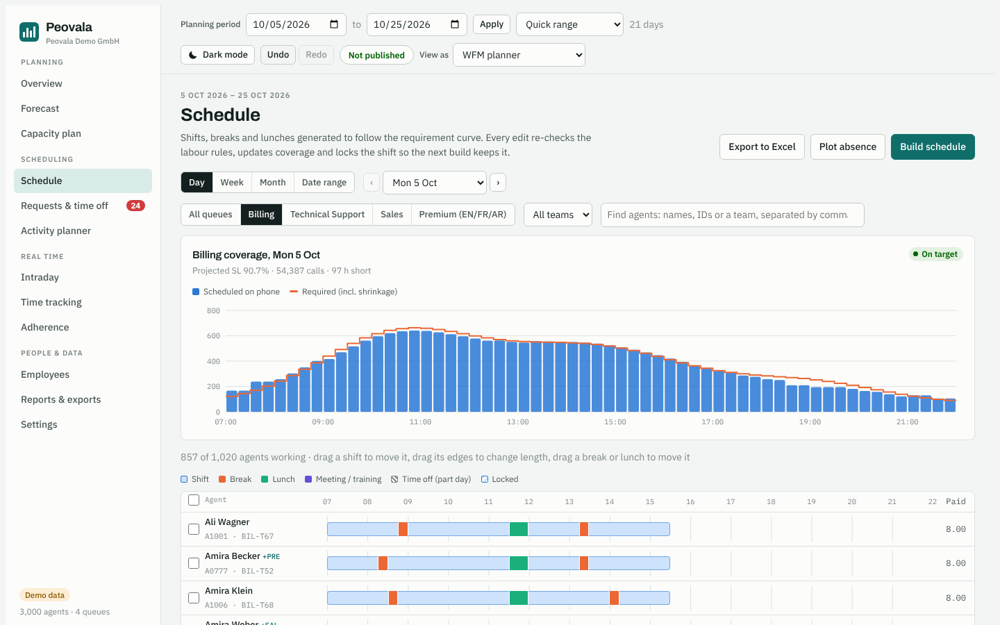
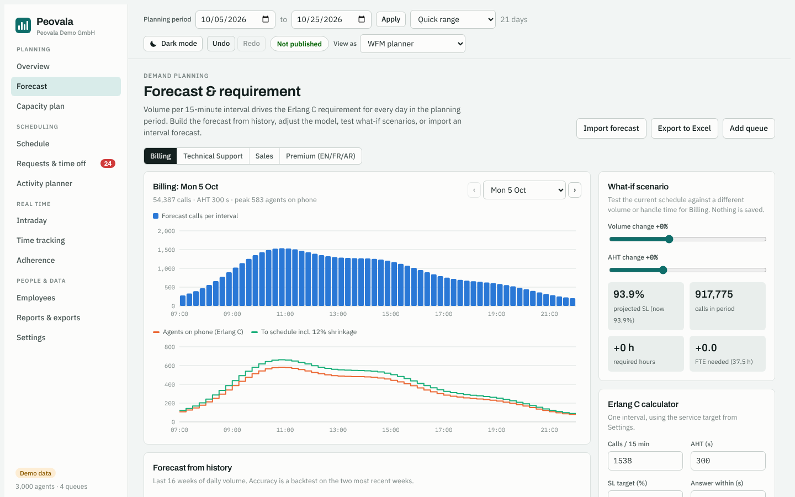
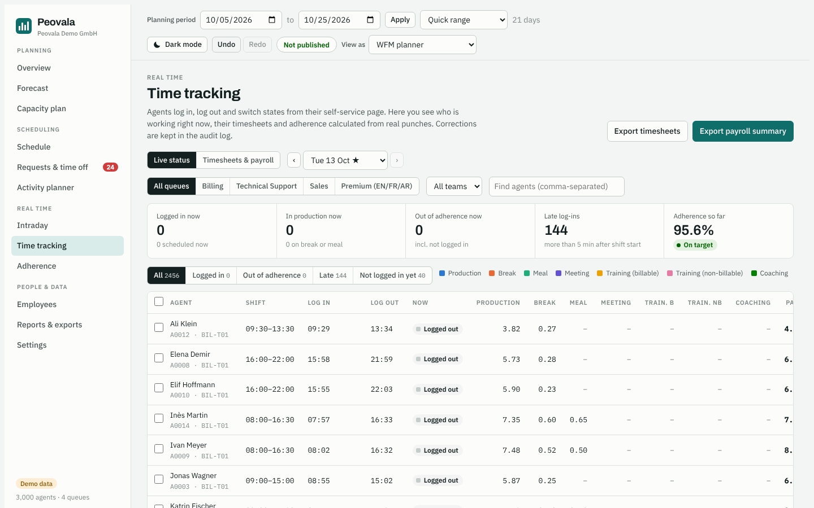

# Peovala

**Workforce management for contact centres.** Peovala forecasts call volume, works out how many agents are needed every 15 minutes, builds shift schedules automatically, and tracks what actually happened, all in the browser.

**[Open the live demo](https://azzam2424.github.io/peovala-demo/)** · no sign-up, it loads with 3,000 sample agents in 4 queues.

## What it does

- **Forecasting and staffing.** Builds an interval forecast from 16 weeks of history, then turns it into an agent requirement with the Erlang C model against a service-level target (for example 80% of calls answered in 20 seconds). Includes a what-if panel for volume and handle-time changes.
- **Automatic scheduling.** Generates shifts, breaks and lunches that follow the requirement curve while respecting contracts, labour rules, rotations, shift bands, weekend fairness, agent preferences and overtime limits. A before/after preview shows the effect of a rebuild.
- **Schedule editing.** Day, week, month and date-range views with drag and drop for shifts, shift edges, breaks and lunches. Every edit re-checks labour rules and updates coverage immediately, with undo/redo and an audit log.
- **Absence and requests.** Bulk absence planning, plus shift swaps, day-off swaps, time off and overtime requests with an approval flow and a self-service agent view.
- **Real time.** Intraday re-forecasting, agent time clock, live status board, timesheets, payroll summary and schedule adherence.
- **Roles and settings.** Planner, supervisor and agent views with permissions, per-queue service levels, opening hours by weekday, holiday calendars and 20+ settings sections.
- **Excel exports** of schedules, forecasts, timesheets and reports.

| Schedule | Forecast |
|---|---|
|  |  |

## How it is built

- **Plain JavaScript, HTML and CSS** with no framework and no build step (about 5,000 lines).
- **Planning engine** (`engine.js`) is independent of the UI and also runs in Node: Erlang C, forecasting, requirement calculation and a heuristic schedule builder that handles 3,000 agents over a 21-day period in the browser.
- **Local-first storage** in IndexedDB, with undo/redo snapshots and an audit trail.
- **Excel export** with SheetJS.
- **End-to-end tests** with Playwright.
- A **server edition** (Node.js, Express, PostgreSQL, multi-tenant with role-based sign-in) is in development.

## Run it locally

Open `index.html` in Chrome, Edge or Firefox, or serve the folder with `python3 -m http.server 8000` and open http://localhost:8000. Data stays in your browser; **Settings → Reset to demo data** restores the sample company.

This repository holds the browser demo only. The full project, including the server edition, tests and developer docs, is kept in a private repository.

## Author

Built by Azzam · [GitHub](https://github.com/Azzam2424)
